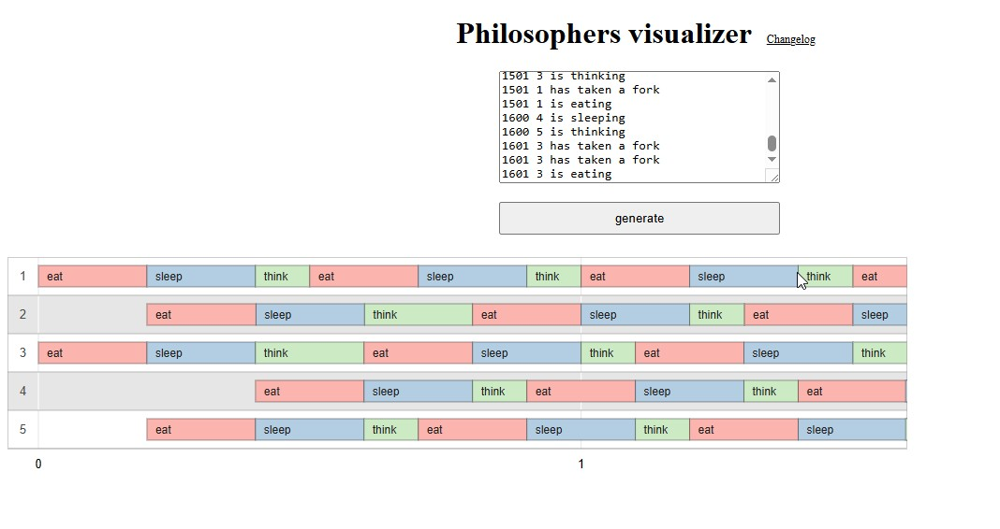

*This project has been created as part of the 42 curriculum by [aalrofat].*

# Philosophers

## Description
The **Philosophers** project is a simulation of one or more philosophers around a table. In this simulation each philosopher is a seperate **thread**. The challenge is to make sure they can all eat, sleep, and think without getting stuck which we call a **deadlock** (where everyone waits for a fork). and prevent **starvation** (where a philosopher dies of hunger).

### what did i learn from the project
Working with processes, threads and Multithreading was a new experience for me. I learned how to manage multiple threads that share the same memory while running at the same time. Also, I learned about **mutexes** and the importance of using them which ensures that two threads don't try to change the same variable at once, which prevents **data races**.

### Testing my philo

*screenshot of my code running successfully on the visualizer.*

## Instructions
1. `cd philo`
2. `make`
3. **For execution**: `./philo 3 800 200 200 5`
    * **3** : Number of philos.
    * **800** : Time to die (ms).
    * **200** : Time to eat (ms).
    * **200** : Time to sleep (ms).
    * **5** : Number of meals must philos eat (optional argument).

## Resources
* [process and thread](https://techterms.com/definition/thread).
* [All about pthreads functions](https://medium.com/@jalal92/the-dining-philosophers-7157cc05315).
* [Mutex and data race](https://www.youtube.com/watch?v=oq29KUy29iQ&list=PLfqABt5AS4FmuQf70psXrsMLEDQXNkLq2&index=4).
* [Philosophers visualizer](https://nafuka11.github.io/philosophers-visualizer/).

### AI Usage
* **Explaining Concepts**: It helped me understand the logic of threads.

* **Code Organization**: I used it to help me split long functions into smaller ones to follow the Norminette rules.

* **Documentation**: It helped me write and check the English in this README file to make it more professional.
